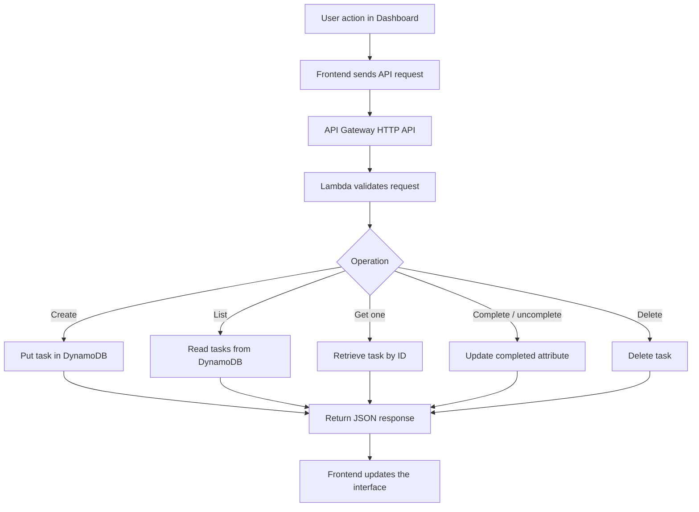
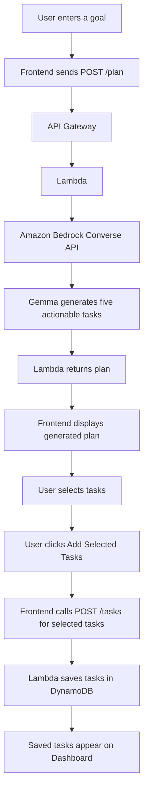

# TaskFlow Quest --- AI-Powered Serverless Task Management

TaskFlow Quest is an AI-powered task management web application built
with AWS serverless services. Users can manage tasks, ask Amazon Bedrock
to break a goal into five actionable tasks, and stay motivated through
XP, levels, and achievement badges.

> **Project purpose:** TaskFlow Quest was built for the **AWS October Challenge**. It demonstrates an AI-powered, serverless task-planning application using Amazon Bedrock and other AWS services.

## Architecture


## Overview

TaskFlow Quest brings together serverless application development,
generative AI, infrastructure as code, and a gamified user experience.

The frontend is a static HTML/CSS/JavaScript application hosted on
GitHub Pages. It sends requests to an Amazon API Gateway HTTP API. AWS
Lambda handles task operations and invokes Amazon Bedrock for
AI-generated plans. Task records are stored in Amazon DynamoDB.

The application currently uses a **single shared, unauthenticated demo
API**. It is intended for demonstration and learning, not for storing
private or sensitive user tasks in a production multi-user environment.

## Live Demo

-   **Frontend:**
    https://luthirapeiris.github.io/aws-serverless-task-api/
-   **GitHub repository:**
    https://github.com/LuthiraPeiris/aws-serverless-task-api
-   **AWS Region:** `ap-south-1` (Asia Pacific --- Mumbai)

## Features

### Task management

-   Create tasks.
-   View all tasks.
-   Retrieve a task by its ID.
-   Update a task's completion state.
-   Delete tasks.
-   Search and filter tasks in the frontend, where supported by the
    current UI.

### AI task planning

-   Enter a goal in the AI Planner.
-   Invoke the existing `/plan` API operation.
-   Use Amazon Bedrock with the `google.gemma-3-4b-it` model to generate
    a plan of five actionable tasks.
-   Review the generated plan and select tasks to save.
-   Save selected tasks through the existing task-creation API.
-   Display successfully saved tasks on the Dashboard.

Generated tasks are suggestions. They are not saved to DynamoDB until
the user selects them and chooses the add/save action.

### Gamification

-   Earn **20 XP** for each currently completed task.
-   Lose that task's 20 XP contribution when it is unchecked.
-   **First Step** badge: at least one completed task.
-   **High Five** badge: at least five completed tasks.
-   Level progression:
    -   **Beginner:** 0--99 XP
    -   **Task Explorer:** 100--199 XP
    -   **Productivity Champion:** 200+ XP

XP is calculated from completed task records. It is not a separate
permanent XP ledger. The frontend derives the XP and badge state from
the tasks returned by the API.

### Request flow

1.  The user opens the static frontend hosted on GitHub Pages.
2.  The frontend sends an HTTPS request to the API Gateway HTTP API.
3.  API Gateway routes the request to the `serverless-task-api` Lambda
    function.
4.  Lambda validates and processes the request.
5.  Task operations read from or write to the `serverless-tasks`
    DynamoDB table.
6.  For AI planning, Lambda calls Amazon Bedrock and returns the
    generated plan to the frontend.
7.  Lambda execution logs and errors are available in CloudWatch.
8.  Terraform defines and manages the AWS infrastructure represented in
    the configuration.

**Deployment note:** The frontend is hosted on GitHub Pages. The GitHub
Actions workflow should be described as the deployment mechanism only if
the repository's current workflow is configured and enabled for that
purpose.

## AWS Services

  -----------------------------------------------------------------------
  Service                             Responsibility
  ----------------------------------- -----------------------------------
  Amazon API Gateway HTTP API         Exposes the application's HTTP
                                      endpoints

  AWS Lambda                          Handles task operations and AI
                                      planning requests

  Amazon DynamoDB                     Stores task records in the
                                      `serverless-tasks` table

  Amazon Bedrock                      Generates five-task plans from a
                                      user goal

  AWS IAM                             Grants the Lambda execution role
                                      the permissions required by the
                                      application

  Amazon CloudWatch Logs              Captures Lambda execution logs and
                                      errors

  Terraform                           Defines and manages AWS
                                      infrastructure

  GitHub Pages                        Hosts the static frontend

  GitHub                              Stores source code and version
                                      history
  -----------------------------------------------------------------------

**Region:** `ap-south-1` (Mumbai) for the AWS resources configured in
this project. GitHub Pages is an external hosting service, not an AWS
service.

## Technology Stack

-   **Frontend:** HTML, CSS, JavaScript
-   **API:** Amazon API Gateway HTTP API
-   **Compute:** AWS Lambda, Node.js 24.x
-   **Database:** Amazon DynamoDB, on-demand billing mode
-   **Generative AI:** Amazon Bedrock Converse API,
    `google.gemma-3-4b-it`
-   **AWS SDK:** AWS SDK for JavaScript v3, including the Bedrock
    Runtime and DynamoDB document clients
-   **Infrastructure as Code:** Terraform
-   **Frontend hosting:** GitHub Pages
-   **Source control:** Git and GitHub

## Application Workflow

### Task CRUD workflow



### AI Planner workflow



## Gamification Rules

XP is derived from task completion:

``` text
totalXP = completedTaskCount * 20
```

For example:

    Completed tasks    XP
  ----------------- -----
                  0     0
                  1    20
                  3    60
                  5   100
                 10   200

When a task is unchecked, it no longer contributes to XP. The frontend
recalculates the level and badge eligibility from the current
completed-task set. Deleting a completed task also removes it from the
set of tasks used for the calculation.

There is no separate persistent XP balance or XP transaction ledger in
the current design.

## Repository Structure

The main project files are organized approximately as follows:

``` text
aws-serverless-task-api/
├── frontend/
│   ├── index.html
│   ├── style.css
│   └── app.js
├── lambda/
│   ├── index.mjs
│   ├── package.json
│   ├── package-lock.json
│   └── function.zip
├── terraform/
│   ├── main.tf
│   └── ...
├── .gitignore
└── README.md
```

Terraform state, local provider files, credentials, and generated
artifacts should not be committed unless there is a deliberate, safe
reason. Check `.gitignore` before committing changes.


## Run the Frontend Locally

1.  Clone the repository:

    ``` bash
    git clone https://github.com/LuthiraPeiris/aws-serverless-task-api.git
    cd aws-serverless-task-api
    ```

2.  Start a local static server from the project root:

    ``` bash
    python -m http.server 3000 --directory frontend
    ```

3.  Open:

    ``` text
    http://localhost:3000
    ```

4.  Confirm that the API's CORS configuration allows the exact local
    origin and the deployed GitHub Pages origin.

The local static server serves only the frontend. API requests still go
to the deployed AWS backend unless you deliberately configure a
different API endpoint in the frontend.

## Deploy and Manage AWS Infrastructure

**Review the Terraform configuration before running commands.** Confirm
the AWS account, region, resources, and expected changes.

From the Terraform directory:

``` bash
cd terraform
terraform init
terraform fmt -check
terraform validate
terraform plan
```

Review the plan carefully. Only apply it when you understand the
proposed changes:

``` bash
terraform apply
```

Terraform may create billable resources or modify existing resources.
Never apply a plan blindly, and never delete the Terraform state to
resolve an error.

### Lambda packaging

The Lambda deployment package includes the function source and required
Node.js dependencies. Follow the existing packaging procedure used by
this repository. After making changes to `lambda/index.mjs` or its
dependencies:

1.  Run a syntax check.
2.  Rebuild the ZIP package with dependencies.
3.  Deploy the updated package using the established project workflow.
4.  Invoke and test the affected endpoint.
5.  Review CloudWatch logs if a request fails.

Do not commit AWS credentials, `.env` files containing secrets, or local
Terraform state.

## Configure Amazon Bedrock

The AI Planner calls Amazon Bedrock from Lambda. The Lambda execution
role needs permission to invoke the selected model, and model access
must be available for the AWS account and region in use.

The model used by this project is:

``` text
google.gemma-3-4b-it
```

## AWS Builder Center Article

For an AWS community article, document the real implementation and what
you learned. Include:

-   The problem TaskFlow Quest addresses and its intended audience.
-   The architecture diagram and request flow.
-   Why API Gateway, Lambda, DynamoDB, and Bedrock were chosen.
-   How the AI planner works and how selected tasks are saved.
-   The gamification logic and its current persistence model.
-   Development challenges, debugging steps, and lessons learned.
-   Screenshots or a short demo.
-   Links to the public repository and live demo.
-   The required challenge tag, `#agents`, if required by the current
    AWS October Challenge rules.

Article URL: *Add the published AWS Builder Center article link here.*

## Roadmap

Possible future improvements, outside the current completed scope:

-   Authentication and per-user task ownership.
-   Persistent user profiles and XP history.
-   Improved task prioritization and due-date handling.
-   Automated tests and continuous integration checks.
-   API throttling and additional abuse protection.
-   More detailed observability and cost monitoring.

These are potential future enhancements, not claims about current
functionality.

## Author

**Luthira Peiris**

-   GitHub: https://github.com/LuthiraPeiris
-   Project: https://github.com/LuthiraPeiris/aws-serverless-task-api
-   Live demo: https://luthirapeiris.github.io/aws-serverless-task-api/

## License

No license has been specified in this README. Add a `LICENSE` file and
update this section if you intend to grant others permission to reuse,
modify, or distribute the project.
